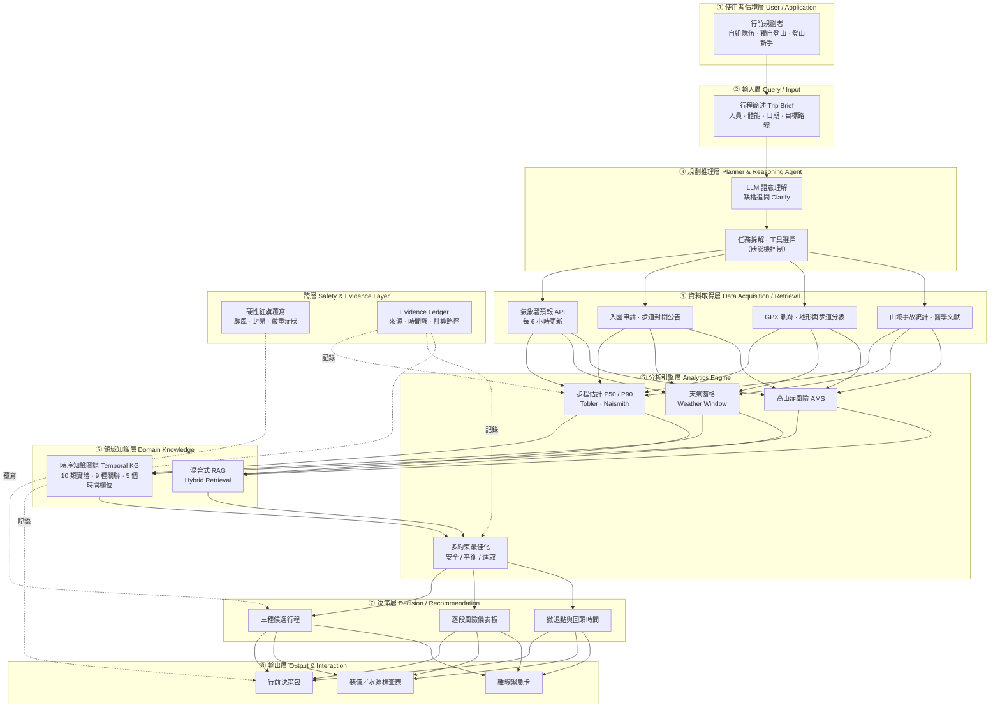
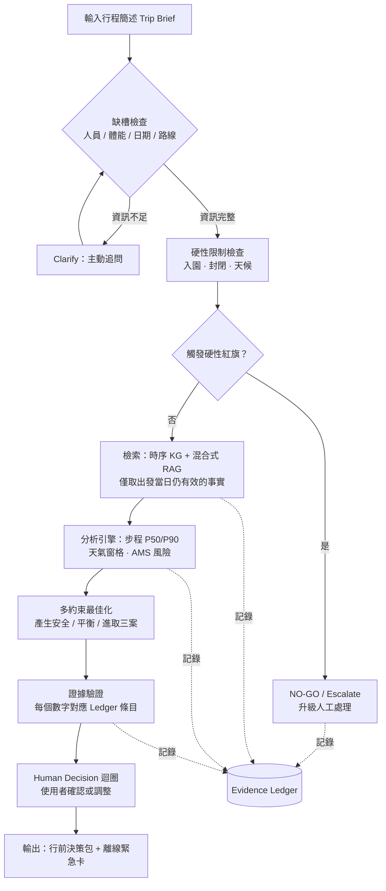

# TrailGuard TW ｜山徑守護者

> 以證據為基礎的臺灣高山行程規劃與風險決策支援代理人
> An evidence-grounded trip-planning and risk-decision support agent for Taiwan's high mountains.


---

## 目錄

- [專案簡介](#專案簡介)
- [問題背景](#問題背景)
- [設計原則](#設計原則)
- [系統架構](#系統架構)
- [處理流程](#處理流程)
- [核心功能](#核心功能)
- [評估指標與實驗設計](#評估指標與實驗設計)
- [專案結構](#專案結構)
- [安裝](#安裝)
- [如何執行](#如何執行)
- [Demo](#demo)
- [開發時程](#開發時程)
- [研究限制](#研究限制)
- [資料來源與參考文獻](#資料來源與參考文獻)
- [文件索引](#文件索引)
- [授權](#授權)

---

## 專案簡介

**TrailGuard TW（山徑守護者）** 是一個「領域 AI 代理人（Domain AI Agent）」，針對臺灣高山行程規劃提供**有證據、可追溯、會說「不要去」**的行前決策支援。

它不是幫使用者決定要不要上山的「自動駕駛」，而是把證據攤開、把風險算清楚、把回頭條件寫明白的**副駕駛**。

本專案依課程規範採用 **AI Agent + Domain Knowledge + Data Analytics + Real-World Application** 的組合，而非單一模型或聊天機器人：

| 組成 | 本專案的實踐 |
| --- | --- |
| AI Agent | LLM 負責語意理解、缺槽追問、結果解釋；規劃與工具選擇走狀態機流程 |
| Domain Knowledge | 山域事故結構、高山症（AMS）、步程模型（Tobler / Naismith）、入園與封閉法規 |
| Data Analytics | 確定性 Python 引擎計算步程 P50/P90、天氣窗格、風險矩陣與多約束最佳化 |
| Real-World Application | 產出可直接帶上山的「行前決策包」與離線緊急卡 |

> **狀態**：目前為**提案（Proposal）階段**。本 README 描述的架構、模組與指標為設計目標；程式碼、實驗數據與 Demo 將於實作階段補上。

---

## 問題背景

2019 年「開放山林」後，臺灣登山人口快速成長，風險卻沒有同步下降：

- 2015–2024 年共發生 **3,450 件**山域事故，其中**迷路約占 37%**；2025 年迷路比例升至 **38.61%**。
- 2025 年遇險者中，**自組隊伍占 55.85%**、**獨自登山占 21.46%**，50–69 歲占 48.8%——正是最缺領隊經驗、最需要行前支援的族群。
- 三座高山型國家公園 2025 年入園人次不到 2020 年的一半，事故率卻從 **0.04–0.05%** 升至 **0.08–0.09%**。人變少，事故率反而翻倍。

**真正的缺口不是資訊不存在，而是資訊沒有被整合成可計算、可追溯的決策。**

- 一站式服務網管許可與封閉公告、氣象署每 6 小時更新預報、社群提供路況、地圖提供步程——但沒有工具會告訴新手：「依你們的配速與當天雷雨窗格，這段 13 時前沒通過就該回頭。」
- 既有 LLM 規劃基準（TravelPlanner、ChinaTravel、COMPASS）只處理預算、時間、偏好等「旅遊約束」，**不處理安全約束**，也不區分「錯誤但安全」與「錯誤而危險」。
- LLM 在多約束規劃上的成功率僅 **0.6%**，實際計算準確率最好約 **63%**，引用有 **50–90%** 未被來源完整支撐，且約 **58%** 的情況會順著使用者說。使用者面對 AI 錯誤答案時，仍有約 **80%** 的機率採納。

換句話說：**危險不在於 AI 會出錯，而在於它出錯時聽起來依然很可信。**

---

## 設計原則

| 原則 | 含義 | 落實方式 |
| --- | --- | --- |
| **No source, no trust** | 沒有來源就沒有信任 | 每個數字都寫入 Evidence Ledger，記錄來源、時間戳與計算路徑 |
| **Safety before optimization** | 安全先於最佳化 | 硬性紅旗（颱風、封閉、重症）直接覆寫所有評分，輸出 NO-GO |
| **Human in the loop** | 人類負責撤退與問責 | AI 負責計算與舉證，人類負責決定與承擔 |

以及一句話總結分工：**讓 LLM 做它擅長的事，把它不擅長的事拿走。**

- 交給 LLM：語意理解、追問缺少資訊、解釋結果。
- 不交給 LLM：精確計算、引用來源、堅持立場。

---

## 系統架構

四層架構 + 一跨層（Safety & Evidence Layer），對應課程規範的 ①–⑧ 模組。



### 為什麼 LLM 不算數字？

計算、引用與立場一致性都是 LLM 的已知弱項，因此本系統採**神經符號分工**：

| LLM 弱項 | 文獻證據 | 本系統對策 |
| --- | --- | --- |
| 精確計算 | 實際計算準確率最好約 63% | 步程、窗格、AMS、最佳化交由 Python 引擎 |
| 引用來源 | 50–90% 引用未被完整支撐 | 每個事實帶來源，寫入 Evidence Ledger |
| 堅持立場 | 約 58% 會順著使用者說 | 狀態機 + 缺槽追問，避免諂媚 |

---

## 處理流程



核心演算法（`Algorithm 1: Evidence-Grounded Trip Planning Agent`、`Algorithm 2: Hard-Constraint and Red-Flag Verification`）將於實作階段提供具行號的 pseudocode，並收錄於 `DESIGN.md`。

---

## 核心功能

一次規劃輸出完整的**行前決策包**：

- [ ] **三個候選行程**：安全 / 平衡 / 進取，各自標明犧牲了什麼
- [ ] **逐段風險儀表板**：每段步道的坡度、曝露、天候窗格與風險等級
- [ ] **撤退點與回頭時間**：門檻型規則，不是連續加權分數
- [ ] **裝備與水源檢查表**：依路線、天數、季節與人員組成生成
- [ ] **離線緊急卡**：無訊號時可用的關鍵資訊（座標、撤退點、聯絡方式）
- [ ] **完整證據鏈**：每一項數字的來源與時間戳記

### 時序知識圖譜（Temporal KG）

臺灣山域資訊具有強烈時效性（例：2026-08-07 多個國家公園全面禁止生態保護區入園，10 月下旬才陸續重開）。因此每個事實都帶有五個時間欄位：

| 欄位 | 說明 |
| --- | --- |
| `observed_at` | 資料被觀測的時間 |
| `retrieved_at` | 資料被抓取的時間 |
| `valid_from` | 事實生效時間 |
| `valid_to` | 事實失效時間 |
| `superseded_by` | 被哪一筆新事實取代 |

檢索時以「**出發當日仍然有效**」作為硬性篩選條件，避免引用已失效的封閉公告或過期預報。

### 硬性紅旗（Non-compensatory）

多數風險評分採加權平均，但某些條件一旦成立就不該被其他優點抵銷：

- 颱風警報
- 步道／生態保護區封閉
- 嚴重高山症症狀

→ 直接輸出 **NO-GO** 或**升級人工處理**，不參與加權。

---

## 評估指標與實驗設計

### 評估指標

| 指標 | 全稱 | 目標 | 說明 |
| --- | --- | --- | --- |
| **CSR** | Constraint Satisfaction Rate | ≥ 85% | 限制滿足率 |
| **EGR** | Evidence Grounding Rate | ≥ 95% | 每個數字皆有可追溯來源的比例 |
| **FSR** | False-Safe Rate | ≤ 2% | 該 NO-GO 卻說可以（錯誤而危險）的比例 |
| **MAPE** | Mean Absolute Percentage Error | ≤ 20% | 步程預測誤差 |
| **P90 覆蓋率** | P90 Coverage | ≥ 85% | 實際時間落在 P90 估計內的比例 |
| **SUS** | System Usability Scale | ≥ 75 | 約第 73 百分位（B 級） |

> **FSR 的意義**：借自醫療分級中的「低估急迫性（undertriage）」概念。本專案刻意區分**錯誤而危險（false-safe）**與**錯誤而保守（false-alarm）**——兩者的成本不對稱，不能只看整體成功率。

### 實驗設計

- **案例數**：120 個（90 個核心情境 + 30 個壓力／對抗案例）
- **涵蓋範圍**：30 條路線 × 3 種人物誌
- **對抗案例類型**：資料衝突、缺少資料、誘導幻覺、使用者高估體能、突發封閉
- **對照組**：GPT-4o zero-shot、GPT-4o + 搜尋、RAG-only、人工流程
- **消融組**：移除時序知識圖譜、移除驗證層、移除紅旗層
- **統計方法**：信賴區間與 McNemar 檢定，避免單一案例論證

### 可檢驗假設（falsifiable）

| 假設 | 內容 | 檢驗方式 |
| --- | --- | --- |
| **H1** | TrailGuard TW 的 CSR 顯著高於 GPT-4o zero-shot 與 GPT-4o + 搜尋 | 120 案例配對比較（McNemar） |
| **H2** | 移除紅旗層後，FSR 顯著上升 | 消融：完整系統 vs. 移除紅旗層 |
| **H3** | 移除時序 KG 後，時效錯誤率顯著上升 | 消融：突發封閉對抗案例 |
| **H4** | 個人化步程模型 MAPE ≤ 20%，P90 覆蓋率 ≥ 85% | 以真實 GPX 軌跡驗證 |
| **H5** | 缺槽追問能降低「順著使用者說」的比例 | 比較有無追問機制的版本 |

---

## 專案結構

> 以下為規劃中的目錄結構，實際內容隨實作推進調整。

```text
trailguard/
├── README.md                  # 本文件：專題介紹、安裝、執行、Demo
├── DESIGN.md                  # 系統設計文件（Problem → Requirements → ... → Results）
├── requirements.txt
├── .env.example               # API 金鑰範本（氣象署、LLM provider）
│
├── app/                       # 對外介面層
│   ├── cli.py                 # 命令列入口
│   ├── api.py                 # FastAPI 服務（規劃中）
│   └── ui/                    # 簡易前端（規劃中）
│
├── core/                      # 核心邏輯
│   ├── planner/               # 狀態機、缺槽追問、任務拆解
│   ├── agent/                 # LLM 工具呼叫與 JSON 契約
│   ├── analytics/             # 步程、天氣窗格、AMS、最佳化
│   ├── knowledge/             # 時序知識圖譜、混合式 RAG
│   ├── safety/                # 硬性紅旗與驗證層
│   └── evidence/              # Evidence Ledger
│
├── data/
│   ├── raw/                   # 原始資料（不進版控）
│   ├── processed/             # 前處理後的資料
│   └── schema/                # 資料與工具契約 schema
│
├── eval/
│   ├── cases/                 # 120 個評估案例
│   ├── adversarial/           # 30 個壓力／對抗案例
│   └── reports/               # 實驗結果
│
└── tests/
```

---

## 安裝

> 以下為預定流程，將於程式碼上線後驗證並更新。

### 環境需求

- Python **3.11+**
- 網際網路連線（取得氣象與封閉公告）
- 可選：LLM API 金鑰（OpenAI / Anthropic / 本地模型）

### 步驟

```bash
git clone <your-repo-url>
cd trailguard

python -m venv .venv
source .venv/bin/activate        # Windows: .venv\Scripts\activate

pip install -r requirements.txt

cp .env.example .env             # 填入 API 金鑰
```

`.env.example`：

```dotenv
# 中央氣象署開放資料
CWA_API_KEY=your_key_here

# LLM（依實際採用方案調整）
LLM_PROVIDER=openai
LLM_API_KEY=your_key_here
LLM_MODEL=gpt-4o

# 資料與紀錄
DATA_DIR=./data
LEDGER_PATH=./data/ledger/evidence.jsonl
```

---

## 如何執行

> 指令為規劃中的介面，實作後以實際 CLI 為準。

### 1. 產生行前決策包

```bash
python -m app.cli plan \
  --route "玉山主峰" \
  --date 2026-12-20 \
  --party 4 \
  --experience beginner \
  --fitness moderate \
  --output ./out/yushan_2026-12-20
```

輸出：

```text
out/yushan_2026-12-20/
├── plan.md              # 行前決策包（三種候選行程）
├── risk_dashboard.html  # 逐段風險儀表板
├── checklist.md         # 裝備與水源檢查表
├── emergency_card.pdf   # 離線緊急卡
└── evidence.jsonl       # Evidence Ledger（來源、時間戳、計算路徑）
```

### 2. 啟動 API 服務

```bash
uvicorn app.api:app --reload --port 8000
```

### 3. 執行評估

```bash
python -m eval.run --cases ./eval/cases --adversarial ./eval/adversarial
```

---

## Demo

> **尚未提供。** 本專案目前處於提案階段，Demo 影片與操作範例將於實作完成後補上。

預定 Demo 內容：

1. 輸入一個「新手 4 人自組隊、12 月單攻玉山主峰」的行程簡述
2. 系統追問缺少的體能與撤退經驗
3. 展示紅旗觸發 → NO-GO 的完整證據鏈
4. 展示正常情境下產出的三種候選行程與撤退點

| 項目 | 連結 |
| --- | --- |
| Demo 影片（YouTube） | _待補_ |
| 簡報（Final PPT） | _待補_ |
| 線上試用 | _待補_ |

---

## 開發時程

16 週里程碑，實際進度將更新於 Issues 與 Project Board。

| 階段 | 週次 | 主要工作 |
| --- | --- | --- |
| 提案 | W1–W4 | 文獻回顧、Research Gap、Proposal 文件與簡報 |
| 資料 | W5–W7 | 資料來源盤點、爬取與清理、時序 KG schema |
| 核心 | W8–W11 | 分析引擎、狀態機、Evidence Ledger、紅旗層 |
| 整合 | W12–W13 | Agent 與工具契約整合、端到端流程 |
| 評估 | W14–W15 | 120 案例實驗、消融、統計檢定 |
| 交付 | W16 | Final Handover：README、DESIGN、PPT、Demo 影片 |

---

## 研究限制

先寫出來，審查時比較站得住：

| 限制 | 說明 | 緩解方式 |
| --- | --- | --- |
| 案例不等於因果 | 國際 AI 誤導案例多為媒體報導，無法證明 AI 是事故主因 | 僅用於說明動機，不用於證明效果 |
| 黃金標準的主觀性 | 「該不該 NO-GO」需要專家判斷 | 請 2–3 位資深領隊獨立標註，計算 Cohen's κ |
| 資料可得性 | 部分事故統計僅有媒體轉述 | 投稿前向國家公園署索取原始資料 |
| 外部效度 | 30 條路線無法涵蓋全部臺灣高山 | 依步道分級 0–6 級分層抽樣 |
| 原型不等於實地成效 | 實驗室評估無法直接推論事故率下降 | 僅宣稱「行前決策品質」，不宣稱「降低事故」 |

---

## 資料來源與參考文獻

主要資料來源：內政部消防署山域事故統計、中央氣象署開放資料、臺灣登山申請一站式服務網、玉山高山症流行病學研究、GPX 公開軌跡，以及相關 AI 規劃與 RAG 文獻。

完整文獻清單（32 筆）與引用對應請見：

- [`TrailGuard TW 預期貢獻與學術價值.pdf`](TrailGuard%20TW%20預期貢獻與學術價值.pdf) §參考文獻
- `DESIGN.md` §References

關鍵引用（節錄）：

| # | 文獻 | 用途 |
| --- | --- | --- |
| [1] | Xie et al. (2024). *TravelPlanner*. ICML. | LLM 多約束規劃成功率 0.6% |
| [4] | *TG-RAG: Temporal Graph RAG*. | 時序知識圖譜方法基礎 |
| [7] | 內政部消防署（2026）。114 年山域事故案件概況。 | 事故統計、族群分布 |
| [9] | Wang et al. (2010). *Epidemiology of AMS on Jade Mountain*. | 高山症盛行率 36% |
| [20] | *Nature Communications* (2025). Citation support in LLMs. | 引用未被支撐比例 50–90% |
| [24] | 中央社（2025-08-21）。玉山東峰雷擊。 | 紅旗層動機案例 |
| [26] | 《人工智慧基本法》（2026-01-14 施行）。 | 人類自主與問責原則 |

---

## 文件索引

| 文件 | 說明 |
| --- | --- |
| `README.md` | 專題介紹、安裝、執行、Demo（本文件） |
| `DESIGN.md` | 系統設計文件：Architecture、Components、Data Flow、Algorithm、Implementation Mapping、Results、Limitations（待補） |
| `山徑守護者規劃.pdf` | 三份核心文件（Document / PPT / DESIGN.md）與課程規範的對照分析 |
| `期末專題提案作業規範.pdf` | 課程提案規範與評分標準 |
| `TrailGuard TW 預期貢獻與學術價值.pdf` | 研究定位、C1–C6 貢獻、H1–H5 假設、A–F 加強版 |
| `TrailGuard TW 預期貢獻與學術價值.docx` | 上述文件的可編輯版本 |
| `300字專業摘要.docx` | 300 字專業摘要 |
| `A4 橫式資訊圖表.pdf` | A4 橫式資訊圖表 |
| `IEEE transaction Systems journal style.docx` | IEEE 期刊格式範本 |
| `A2Z outline example.pdf` | A–Z 論文大綱 SOP |

---

## 授權

授權條款尚未決定（`TBD`）。於正式開源前請勿商業使用或再散布。

---

<div align="center">

**TrailGuard TW** — 讓 AI 負責計算與舉證，讓人類負責撤退與問責。

</div>
